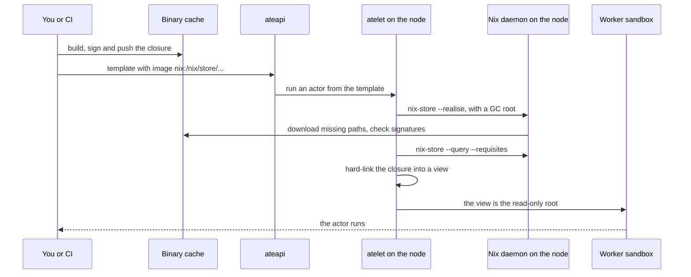

# Nix images

How store paths become running actors and Kubernetes system pods, and how to publish them without a container registry.
Read [concepts.md](concepts.md) first if "closure" or "binary cache" is new to you.

The actor interface remains `patches/substrate/0001-atelet-nix-image-source.patch` on Substrate v1.0.0. It also adds `docs/guides/nix-images.md` to the pinned source.
System pods use the separate [registry-free Substrate integration](#registry-free-substrate-system-pods) below; these two reference formats are not interchangeable.

## The reference

A container `image`, or an image volume, can be:

```text
nix:/nix/store/<hash>-<name>
```

- `<hash>` is the 32-character Nix hash. `<name>` is the package name.
- The path must be a build result. A derivation (a path that ends in `.drv`) is refused: a node downloads images and never builds them.
- The path must be directly under `/nix/store`. A file inside a store path is not a valid reference.
- The patched `ateapi` accepts this reference as pinned. The hash names the build inputs, and the signature that the node requires ties the path to its content. The unpatched `ateapi` rejects the reference, because upstream requires an OCI digest.

OCI images continue to work on the same node, in the same cluster.

## What happens when an actor starts



1. atelet asks the node's Nix daemon to substitute the store path. The daemon downloads only the paths that the node does not have. The daemon applies the node's own trust rules. atelet passes no cache address and no key.
2. atelet asks the daemon for the list of paths in the closure.
3. atelet builds a **view**: a directory that contains a hard link to each file of each path in the closure, and to nothing else. A hard link uses no extra disk space.
4. atelet gives the view to the worker as the bottom layer of the actor's filesystem. Substrate already has this contract for OCI images (`rootfs-overlay.json`), so the gVisor and microVM workers are not changed.

The node never evaluates Nix code and never builds a package. If no trusted cache has the path, the actor does not start.

A second actor from the same image reuses the view. If the node already has the full closure, the daemon downloads nothing.

## What the actor sees

- `/nix/store/<path>` for each path in the closure. No other path from the node's store.
- For each top-level directory of the image's root path (`bin`, `etc`, `lib`, ...), a directory of the same name. Its entries link into the root path. An image built from bash therefore has `/bin/bash`.
- Empty `/proc`, `/sys`, `/dev`, `/tmp` and `/etc` if the image does not provide them.
- A private writable layer on top, as with an OCI image. Files that the actor writes are in its snapshots.

The view is read-only. An actor cannot add a package to its image at run time. If a process in the actor writes under `/nix/store`, the write is refused or goes to the actor's private layer. The node's store and other actors do not change ([proof.md](proof.md)).

## Build an image

`pkgs.ateNixImage` merges packages into one tree and adds the optional image config:

```nix
pkgs.ateNixImage {
  name = "agent-env";
  paths = [ pkgs.bashInteractive pkgs.coreutils pkgs.ripgrep ];
  config = {
    Entrypoint = [ "/bin/bash" ];
    Env = [ "PATH=/bin" ];
  };
}
```

`nix build .#example-image` builds a small one from this repository. The result is the store path to put after `nix:`.

### Image config

An OCI image carries its start command and environment in its config. A Nix image can carry the same fields in a file named `ate-image-config.json` at the top of its root path. `ateNixImage` writes that file from `config`.

| Field | Meaning |
| --- | --- |
| `Entrypoint`, `Cmd` | The command to start. |
| `Env` | Environment variables, as `NAME=value` strings. |
| `WorkingDir` | The directory in which the command starts. |
| `User` | The user that runs the command. A name is looked up in the image's `/etc/passwd`. |

The template's `command`, `args` and `env` override these fields, exactly as they do for an OCI image.
Without the file, the template must set `command`.

`ateNixImage` is a convenience. Any store path works as an image, for example a `pkgs.buildEnv` result.

## Publish and use an image

1. Build the image and note its store path.
2. Sign its closure and copy it to your binary cache (`nix copy --to <cache> <store path>`). A path from the public Nix package set is already in `cache.nixos.org`, signed.
3. Make sure that each node trusts the cache and its key. See [operating.md](operating.md).
4. Create a template with `image: nix:<store path>`. `kind/proof-template.yaml` is a complete example.

Keep each closure that a live or suspended actor uses in your cache. A suspended actor does not hold a view on a node. When the actor resumes on a node that lacks the closure, the node downloads it again.

## Cleanup on the node

Each view registers a GC root, so the Nix garbage collector does not delete a closure that a view stands for.
If atelet cannot build a view, it removes the GC root again.
atelet removes a view and its GC root when no actor on the node uses the view and the view is older than `--image-cache-min-age`. This check runs on the same schedule as upstream's image cache cleanup (`--image-cache-gc-period`).
After that, the node's normal `nix-collect-garbage` schedule frees the disk space.

## Limits

- The actor's store is read-only. There is no way for an agent to install a package into its image while it runs.
- The `nix:/` actor interface is not [nix-snapshotter](https://github.com/pdtpartners/nix-snapshotter). Kubernetes pods, including Substrate workers, use the separate `nix:0` snapshotter interface below. Actors continue to use root trees, not snapshotter archives.
- [proof.md](proof.md) lists what is tested and what is not.

## Registry-free Substrate system pods

There are two independent runtime interfaces:

| Consumer | Reference | Built artifact | Runtime |
| --- | --- | --- | --- |
| Kubernetes system pods and `WorkerPool.spec.workerImage` | `nix:0/nix/store/<hash>-nix-image-<name>.tar` | Snapshotter archive plus Nix closure | containerd and nix-snapshotter |
| Demo and application ActorTemplates, including actor image volumes | `nix:/nix/store/<hash>-<name>` | Root tree plus Nix closure | patched atelet |

A worker is a Kubernetes container, not an actor: the controller puts `workerImage` into a Deployment's container image. The generated map therefore uses snapshotter archives for both workers and control-plane pods, and root trees for `counter`, `egress`, `fspersist`, and `sandbox`. It does not change the existing actor loader.

### What “registry-free” does and does not mean

No container registry is needed to build, publish, resolve, or start the mapped Substrate workloads. The packages do not download OCI base images. They build Go/Rust programs and runtime roots with Nix; Envoy uses its hash-pinned upstream release executable, not an OCI image.

This is **not an OCI-format-free runtime**. Upstream nix-snapshotter's `buildImage` writes an OCI archive with image configuration, a manifest, and a small layer of mountpoints and symlinks. Writable directory metadata for services such as PostgreSQL is also built locally as a base layer. Runtime program/library bytes come from signed Nix closures; nodes do not fetch conventional application filesystem layers from a registry. If the requirement is literally “no OCI archives, metadata, or layers of any kind”, this snapshotter architecture does not meet it. The independent actor root-tree interface does not require these archives.

The package set includes every installer component, Envoy's Substrate dynamic module, PostgreSQL, RustFS, AWS CLI, OpenTelemetry Collector Contrib, Jaeger, and Prometheus. The node module also supplies and preloads Kubernetes' pause program. The generated map has 17 component/Envoy entries and six exact upstream-reference replacements. Build-time manifest checks reject a changed third-party pin rather than silently leaving the newly pinned image unmapped.

The supported profiles are the bundled local install and the portable existing-cluster/S3 install. Optional Cloud SQL, agentgateway, externally selected demos, and unrelated cluster add-ons are not converted by this set. An image map may contain additional exact digest-reference replacements, but enabling an optional overlay without supplying its replacement can still cause a registry pull. The no-registry assertion applies to the generated map and supported profiles, not arbitrary operator overlays or the Kubernetes distribution itself.

### Why nix-snapshotter rather than nix-csi?

[nix-csi, now nixkube](https://github.com/Lillecarl/nix-csi/blob/main/README.md), delivers closures through CSI ephemeral volumes or NRI mounts. A pod still has a container `image:` and must be taught its store-path commands, environment, and mounts. Its [node DaemonSet](https://github.com/Lillecarl/nix-csi/blob/main/kubenix/daemonset.nix) uses a Nix/appstarter init carrier image and a scratch main image; CSI helper containers also need their own bootstrap images. These can be preloaded, but volume delivery alone does not eliminate image bootstrap or turn arbitrary existing pod images into closure-backed images.

[nix-snapshotter](https://github.com/pdtpartners/nix-snapshotter/tree/v0.4.0) operates at containerd's snapshot/CRI image layer. Its [builder](https://github.com/pdtpartners/nix-snapshotter/blob/v0.4.0/package.nix) preserves the image configuration supplied here, and its [CRI image service](https://github.com/pdtpartners/nix-snapshotter/blob/v0.4.0/pkg/nix/image_service.go) realizes a `nix:0` archive and loads it directly into containerd. Existing Substrate pod command, environment, user and volume semantics can therefore remain in the manifests instead of migrating every workload to CSI volume requests.

The integration uses standalone upstream nix-snapshotter v0.4.0, with the `globset` revision and hash pinned by that release. The generic patches:
- fix [nix-snapshotter #183](https://github.com/pdtpartners/nix-snapshotter/issues/183): containerd ≥2.2 can mistake the last store-path bind mount for the whole root filesystem while looking up users/groups; store mounts use type `none` with the same `ro,rbind` options, and the matching unit-test expectation is changed too;
- return bounded Nix substitution diagnostics to the CRI caller, rather than only `exit status 1`.

No custom RKE2/containerd rebuild is required for standalone containerd. **Do not register this proxy plugin over RKE2's embedded `nix` plugin:** some RKE2 builds already compile it in, and duplicate registration fails. K3s/RKE2 also manage their own containerd configuration and kubelet image endpoint; the module intentionally refuses those managed runtimes rather than pretending to configure them.

### Build and publish

Use a native Linux builder for the target node architecture (`x86_64-linux` or `aarch64-linux`). Evaluation on a Mac is not a Linux build or runtime proof.

```sh
nix build .#nix-snapshotter .#substrate-image-map .#substrate-nix-bundle
bundle=$(nix build --no-link --print-out-paths .#substrate-nix-bundle)
cat "$bundle/image-map"
nix path-info --recursive "$bundle"
```

The bundle links `image-map`, `pods/*.tar`, and `actors/*`. Its recursive closure includes the archives, archive closure metadata, executables, libraries, and actor roots. Keep the bundle GC-rooted on the publisher until publication finishes.

Choose a signing key and a writable binary-cache destination. For example, a local cache served read-only by your HTTP server:

```sh
umask 077
nix key generate-secret --key-name ate-cache-1 > /secure/ate-cache.sec
nix key convert-secret-to-public < /secure/ate-cache.sec > /secure/ate-cache.pub

PUBLISH_CACHE=file:///srv/nix-cache
nix store sign --recursive --key-file /secure/ate-cache.sec "$bundle"
nix copy --to "$PUBLISH_CACHE" "$bundle"
cat /secure/ate-cache.pub
```

Use your own paths and cache transport; provision `/secure` and `/srv/nix-cache` first. An S3/SSH cache may be used instead. HTTP is ordinarily the node's read endpoint, not a writable `nix copy --to https://...` destination. Cache credentials and the signing secret are never package inputs. Do not put credentials in substituter URLs: diagnostics may include the URL.

### Prepare every node before installation

A node needs Linux, Nix, a signed binary cache it trusts, containerd, its OCI runtime/CNI, and the snapshotter **before** kubelet can run these pods. Provision the Kubernetes control plane and networking separately. This repository does not make cluster bootstrap image-free.

The API server and kubelets must expose PodCertificateRequest and ClusterTrustBundle projection support. Match the pinned installer's local-cluster setup: enable `ClusterTrustBundle`, `ClusterTrustBundleProjection`, and `PodCertificateRequest`, and enable the `certificates.k8s.io/v1beta1` API where that release still gates it. The image service cannot provide missing Kubernetes APIs.

The stock gVisor SandboxConfig also downloads hash-pinned public gVisor release assets from Google Storage. That is not a container-registry pull, but it is another network/bootstrap dependency. Pre-stage or mirror those assets before a fully disconnected actor smoke; image publication alone does not publish sandbox assets.

For an ordinary NixOS containerd/kubelet node, import both modules:

```nix
{
  imports = [
    inputs.ate-nix.nixosModules.ate-node
    inputs.ate-nix.nixosModules.nix-snapshotter
  ];

  services.ate-node.nixImages = {
    enable = true;
    substituters = [ "https://cache.example.org" ];
    trustedPublicKeys = [ "ate-cache-1:YOUR_PUBLIC_KEY_BASE64" ];
  };
  services.ate-node.snapshotter.enable = true;
}
```

Replace the example endpoint/key with the cache's public values, then apply your node configuration through its normal NixOS deployment process. The actor module creates the hard-link view bind mount. The actor module also exposes a non-recursive `/nix` bind at `/var/lib/ate-nix`: atelet must mount this raw store view rather than NixOS's read-only `/nix/store` child bind, otherwise hardlink creation can fail across mounts. The snapshotter module:
- uses `/run/nix-snapshotter/nix-snapshotter.sock` for the snapshotter and CRI image service, and `/run/containerd/containerd.sock` for the CRI runtime;
- configures containerd's `nix` proxy snapshotter, snapshot annotations, and transfer unpacking;
- runs Nix requests through the node's daemon with signature checking, no local build jobs, and no builders;
- configures NixOS kubelet's image-service endpoint when that kubelet is enabled;
- preloads a closure-backed pause archive before kubelet, because containerd's internal sandbox-image acquisition does not go through kubelet's external image service.

For an externally managed kubelet, set `--image-service-endpoint=unix:///run/nix-snapshotter/nix-snapshotter.sock` in its own configuration and order startup after `ate-pause-image.service`. Keep its runtime endpoint on containerd. Non-NixOS nodes require equivalent Nix/systemd/containerd provisioning; installing the package alone is insufficient. Likewise, `kind/node-setup.sh` prepares **actor** Nix access, not the snapshotter. A Kind install needs equivalent snapshotter/CRI provisioning inside every Kind node; merely adding `--kind` does not do that.

On each prepared node:

```sh
systemctl is-active nix-snapshotter containerd ate-pause-image
crictl images
crictl info
```

`crictl images` must answer through the image-service endpoint; service readiness alone is not proof that the asynchronous backend connection is established.

### Install the mapped system

Build/install `ate-substrate` and put `ate-setup`, `kubectl-ate`, `kubectl`, and `kustomize` on the operator's PATH as described in [getting-started.md](getting-started.md). Use absolute map paths. `--image-map` excludes `--image-repo` and `--image-tag`, and `ATE_IMAGE_MAP` is its environment equivalent.

For an existing cluster, first provision the S3 Secret and configuration described in [operating.md](operating.md), then:

```sh
map=$(nix build --no-link --print-out-paths .#substrate-image-map)
export KUBECONFIG=/absolute/path/to/kubeconfig
ate-setup deploy ate-system --existing-cluster \
  --config /absolute/path/to/ate-config.json \
  --image-map "$map" --sandbox-classes=gvisor --no-dev-env --no-report-defaults
```

For an already bootstrapped local Kind cluster whose **every node** has the snapshotter and trusted cache configured:

```sh
ate-setup deploy ate-system --kind \
  --config /absolute/path/to/ate-config.json \
  --image-map "$map" --sandbox-classes=gvisor --no-dev-env --no-report-defaults
```

The latter installs the bundled local PostgreSQL/object-store/observability services through the six exact-reference replacements. Neither command builds with ko, resolves registry tags, or pushes images. Both commands select gVisor explicitly: upstream also defaults to microVM, whose automatic asset staging uses GCS. A microVM installation requires separately provisioned sandbox assets and an S3-backed configuration; a registry-free image map does not migrate that asset-distribution path.

Enable the actor loader on the atelet DaemonSet too; installing snapshotter pod images does not automatically turn on atelet's separate actor interface. The existing `kind/atelet-nix.patch.json` shows the required `/nix` mount and flags. On the NixOS nodes above, use the system profile's client:

```sh
jq 'map(
  if .value == "--nix-store-command=/nix/var/nix/profiles/default/bin/nix-store"
  then .value = "--nix-store-command=/nix/var/nix/profiles/system/sw/bin/nix-store"
  else . end
)' kind/atelet-nix.patch.json > /tmp/atelet-nix-nixos.patch.json
kubectl -n ate-system patch daemonset atelet --type=json \
  --patch-file /tmp/atelet-nix-nixos.patch.json
```

The `/nix/var/nix/profiles/system` path remains reachable through the pod's `/nix` mount; `/run/current-system` does not. Preserve all existing atelet arguments. Keep this additive patch in a persistent deployment overlay, because a later installer apply can replace it. The JSON patch is for the first application; inspect the DaemonSet before applying it again to avoid duplicate mount/volume names.

### Validation and retained evidence

No live-cluster verification is claimed by this guide. The permanent checks below passed on an `x86_64-linux` builder on 2026-11-14; see [proof.md](proof.md#registry-free-pod-delivery) for the exercised runtime and limits:

```sh
nix build .#substrate-image-map-check .#substrate-envoy-module-check
nix run .#substrate-installer-tests
nix build .#checks.x86_64-linux.registry-free-node
```

The image-map check runs the complete images test package with the **built** map. It checks every component/third-party map entry against the same manifest/demo trees used by upstream's existing coverage test and exercises worker versus actor reference roles without a registry lookup. The installer test executable runs the full images, config, and steps modules without `-run` filtering. The Envoy check loads both the real listener and HTTP dynamic filters, in addition to Rust unit tests. The VM check boots standalone containerd, serves signed closures from a test cache, blocks external HTTP/HTTPS, starts a real CRI container with user/group lookup and file-backed store mounts, and refuses an unsigned archive. It does not install or qualify an entire Substrate cluster.

For an actual installation, retain these outputs:

```sh
kubectl -n ate-system get pods -o wide
kubectl -n ate-system get pods -o json |
  jq -r '.items[] | .metadata.name as $pod | ((.spec.initContainers // []) + .spec.containers)[] | [$pod,.name,.image] | @tsv'
kubectl get workerpools -A -o json |
  jq -r '.items[] | [.metadata.namespace,.metadata.name,.spec.workerImage] | @tsv'
kubectl -n ate-system get events --sort-by=.lastTimestamp
```

All supported Substrate pod/worker images must be `nix:0...`, not registry references. Inspect ActorTemplates through the existing `kubectl-ate` API and require `nix:/...` for the mapped demos. On a fresh node, keep cache access logs/narinfo signature evidence and containerd/snapshotter logs while starting a mapped pod. Refuse registry egress during that smoke: an image string alone does not prove no registry traffic occurred.

Retain each published bundle for as long as any installation or suspended actor can reference it. Snapshotter GC roots protect live snapshots' closures; atelet independently roots actor views. Cache retention and node garbage collection remain separate responsibilities.
