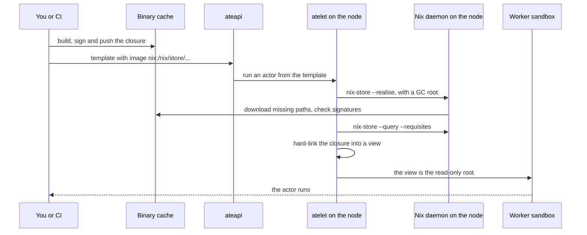

# Nix images

How a store path becomes a running actor, and how to build one.
Read [concepts.md](concepts.md) first if "closure" or "binary cache" is new to you.

The change is one patch on Substrate v1.0.0: `patches/substrate/0001-atelet-nix-image-source.patch`.
The patch also adds an operator guide to the Substrate source tree, `docs/guides/nix-images.md`.

## The reference

A container `image`, or an image volume, can be:

```text
nix:/nix/store/<hash>-<name>
```

- `<hash>` is the 32-character Nix hash. `<name>` is the package name.
- The path must be a build result. A derivation (a path that ends in `.drv`) is refused: a node downloads images and never builds them.
- The path must be directly under `/nix/store`. A file inside a store path is not a valid reference.
- The patched `ateapi` accepts this reference as pinned. The hash names the build inputs, and the signature that the node requires ties the path to its content. The unpatched `ateapi` rejects the reference, because upstream requires an OCI digest.

OCI images continue to work on the same node, in the same cluster.

## What happens when an actor starts



1. atelet asks the node's Nix daemon to substitute the store path. The daemon downloads only the paths that the node does not have. The daemon applies the node's own trust rules. atelet passes no cache address and no key.
2. atelet asks the daemon for the list of paths in the closure.
3. atelet builds a **view**: a directory that contains a hard link to each file of each path in the closure, and to nothing else. A hard link uses no extra disk space.
4. atelet gives the view to the worker as the bottom layer of the actor's filesystem. Substrate already has this contract for OCI images (`rootfs-overlay.json`), so the gVisor and microVM workers are not changed.

The node never evaluates Nix code and never builds a package. If no trusted cache has the path, the actor does not start.

A second actor from the same image reuses the view. If the node already has the full closure, the daemon downloads nothing.

## What the actor sees

- `/nix/store/<path>` for each path in the closure. No other path from the node's store.
- For each top-level directory of the image's root path (`bin`, `etc`, `lib`, ...), a directory of the same name. Its entries link into the root path. An image built from bash therefore has `/bin/bash`.
- Empty `/proc`, `/sys`, `/dev`, `/tmp` and `/etc` if the image does not provide them.
- A private writable layer on top, as with an OCI image. Files that the actor writes are in its snapshots.

The view is read-only. An actor cannot add a package to its image at run time. If a process in the actor writes under `/nix/store`, the write is refused or goes to the actor's private layer. The node's store and other actors do not change ([proof.md](proof.md)).

## Build an image

`pkgs.ateNixImage` merges packages into one tree and adds the optional image config:

```nix
pkgs.ateNixImage {
  name = "agent-env";
  paths = [ pkgs.bashInteractive pkgs.coreutils pkgs.ripgrep ];
  config = {
    Entrypoint = [ "/bin/bash" ];
    Env = [ "PATH=/bin" ];
  };
}
```

`nix build .#example-image` builds a small one from this repository. The result is the store path to put after `nix:`.

### Image config

An OCI image carries its start command and environment in its config. A Nix image can carry the same fields in a file named `ate-image-config.json` at the top of its root path. `ateNixImage` writes that file from `config`.

| Field | Meaning |
| --- | --- |
| `Entrypoint`, `Cmd` | The command to start. |
| `Env` | Environment variables, as `NAME=value` strings. |
| `WorkingDir` | The directory in which the command starts. |
| `User` | The user that runs the command. A name is looked up in the image's `/etc/passwd`. |

The template's `command`, `args` and `env` override these fields, exactly as they do for an OCI image.
Without the file, the template must set `command`.

`ateNixImage` is a convenience. Any store path works as an image, for example a `pkgs.buildEnv` result.

## Publish and use an image

1. Build the image and note its store path.
2. Sign its closure and copy it to your binary cache (`nix copy --to <cache> <store path>`). A path from the public Nix package set is already in `cache.nixos.org`, signed.
3. Make sure that each node trusts the cache and its key. See [operating.md](operating.md).
4. Create a template with `image: nix:<store path>`. `kind/proof-template.yaml` is a complete example.

Keep each closure that a live or suspended actor uses in your cache. A suspended actor does not hold a view on a node. When the actor resumes on a node that lacks the closure, the node downloads it again.

## Cleanup on the node

Each view registers a GC root, so the Nix garbage collector does not delete a closure that a view stands for.
If atelet cannot build a view, it removes the GC root again.
atelet removes a view and its GC root when no actor on the node uses the view and the view is older than `--image-cache-min-age`. This check runs on the same schedule as upstream's image cache cleanup (`--image-cache-gc-period`).
After that, the node's normal `nix-collect-garbage` schedule frees the disk space.

## Limits

- The actor's store is read-only. There is no way for an agent to install a package into its image while it runs.
- This is not [nix-snapshotter](https://github.com/pdtpartners/nix-snapshotter). nix-snapshotter lets ordinary Kubernetes pods run from Nix store paths. This patch does the same thing for Substrate actors only. The Substrate system pods themselves still use OCI images.
- [proof.md](proof.md) lists what is tested and what is not.
